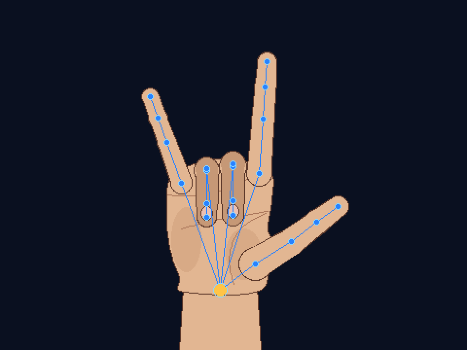
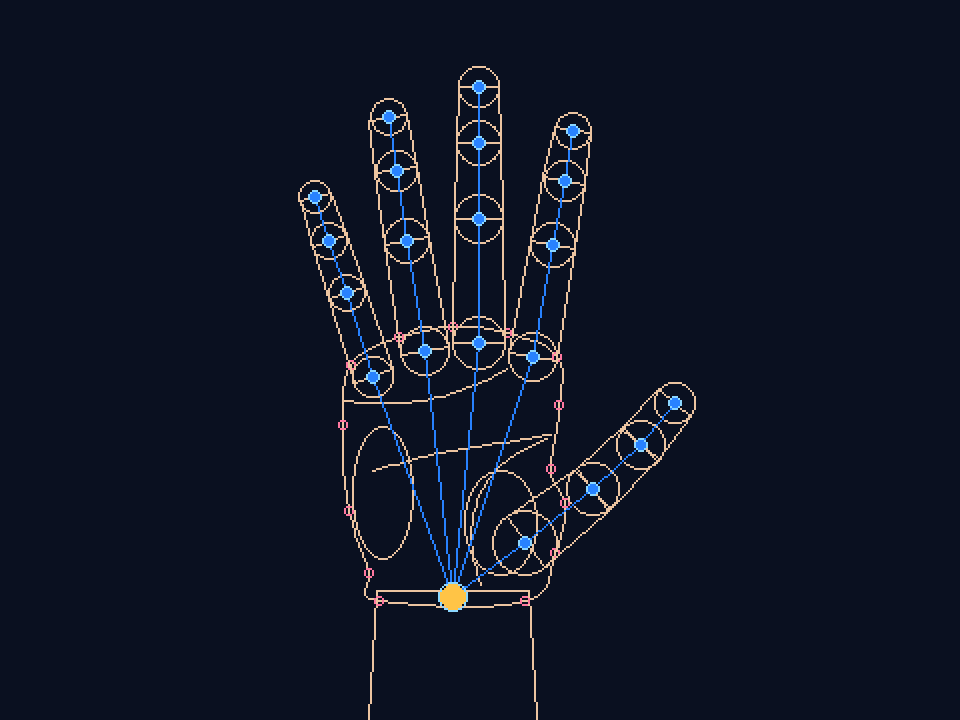
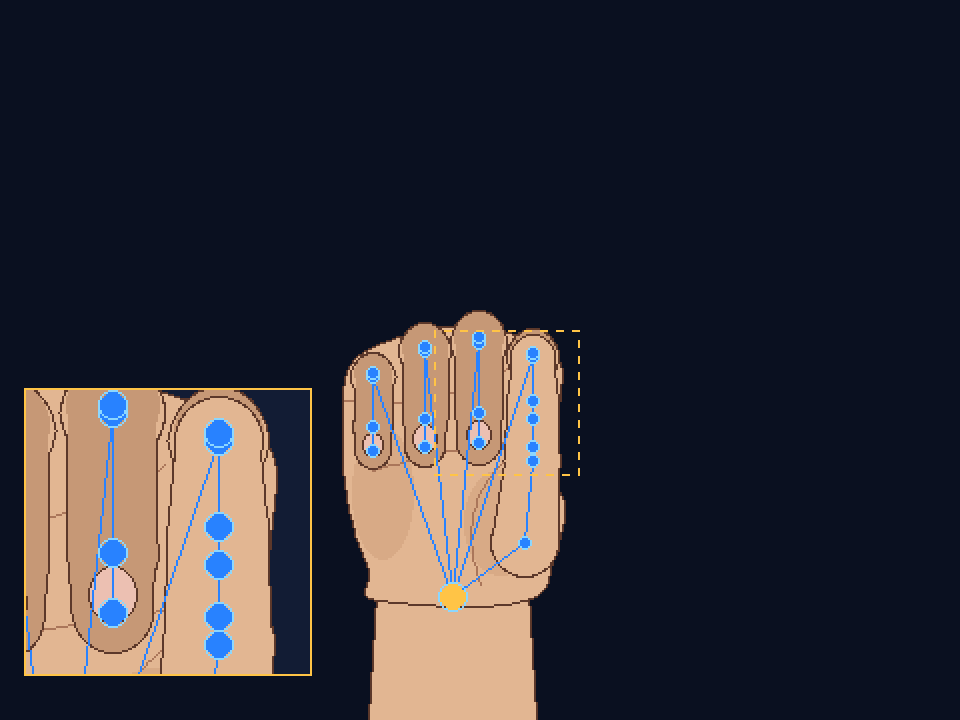
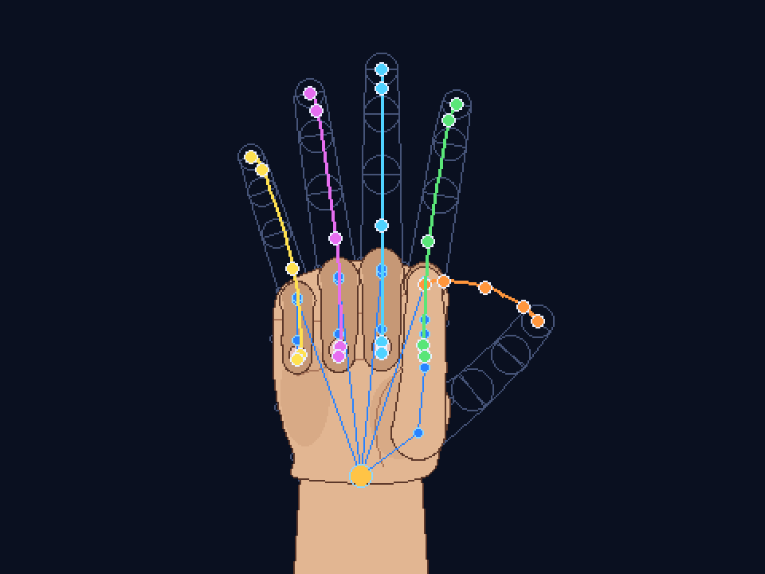
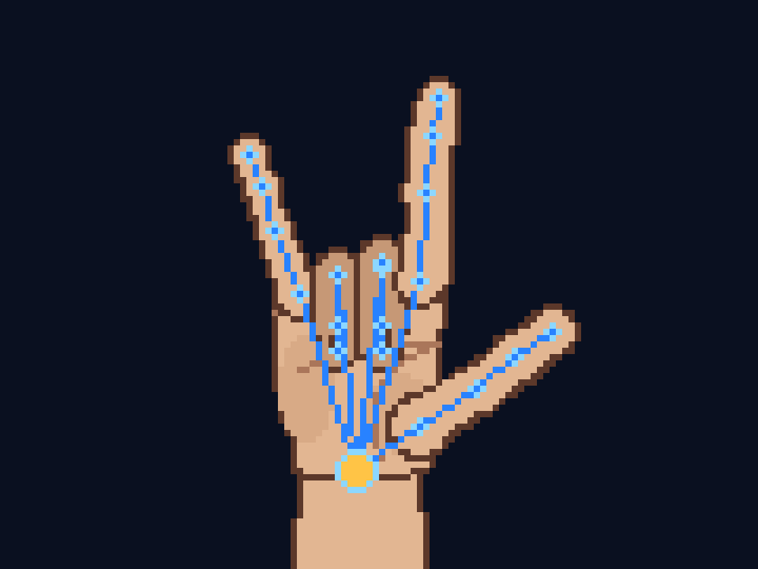

# Sign Language Gesture Visualizer

An interactive visualizer that shows American Sign Language (ASL) handshapes on a rigged hand, built for our Computer Graphics semester project. When finished, learners will be able to watch signs being formed (Watch mode) and pose the hand themselves (Build mode).

**Current stage: Checkpoint 1 – Technical Foundation.**
The hand is built from lines, circles, ellipses, polygons and curves, all drawn by our own algorithms in **pure C++**. The main program uses only the C++ standard library: no OpenGL, no window library, no image library. It draws every pixel itself and saves the results as `.bmp` images with its own BMP writer.



| Wireframe: polygons, circles, ellipses, spline control points | Detail view: clipping and window-to-viewport |
|---|---|
|  |  |
| **Motion trail: spline through 5 keyframes (sign 5 → A)** | **8× pixels: the steps each algorithm produces** |
|  |  |

## Group members and responsibilities

| Member | Responsibility | Main files |
|---|---|---|
| Abdalla Muhammad (169962) | Hand rig, joint hierarchy, forward kinematics, drawing the hand (detail view, motion trails), build setup | `src/Hand.*`, `src/HandRenderer.*`, `CMakeLists.txt`, `build.bat`, `.gitignore` |
| Elvis Wafuke (154210) | Line algorithms (DDA, Bresenham, line attributes); Bézier curves and splines; the algorithm pages | `src/Raster.h`, `src/RasterLines.cpp`, `src/Curves.*`, `src/TestScene.*` |
| Ilhan Hamud (169004) | Framebuffer, point clipping and BMP output; points and polygon operations; circle and ellipse algorithms; OpenGL viewer | `src/Framebuffer.*`, `src/Geometry.*`, `src/RasterCircles.cpp`, `src/RasterEllipses.cpp`, `apps/viewer_glut.cpp` |
| Joy Wanjohi (159540) | Scan-line polygon fill; Cohen–Sutherland and Sutherland–Hodgman clipping; Canvas; interactive Windows viewer | `src/RasterPolygons.cpp`, `src/Clipping.*`, `src/Canvas.*`, `apps/viewer_win32.cpp` |
| Benson Gitonga (156740) | Sign library, the Checkpoint 1 renderer, automated tests, documentation | `src/Poses.*`, `apps/cp1_render.cpp`, `tests/render_test.cpp`, `README.md`, `docs/` |

## Technologies and tools

| Tool | Used for |
|---|---|
| **C++17** with the standard library only | All graphics algorithms and the main program |
| Visual Studio 2022 (MSVC) or g++ | Compiling |
| `build.bat` / CMake (optional) | Building |
| Git and GitHub | Version control, issues, collaboration |
| Windows' built-in window functions (user32, gdi32) | Only for the interactive viewer `apps/viewer_win32.cpp`: opening the window, reading keys, copying our finished pixels to the screen and drawing text labels. All drawing is still done by our code. |
| *Optional:* OpenGL + freeglut | An alternative viewer, `apps/viewer_glut.cpp`, that works the same way. OpenGL proper comes in Checkpoint 3. |

## Graphics techniques implemented so far

| Topic | Algorithm(s) | Used in the hand for | File |
|---|---|---|---|
| Lines | DDA, Bresenham (all 8 octants) | Skeleton bones, outlines, curves | `RasterLines.cpp` |
| Line operations | Dashed/dotted patterns, thick lines (pixel replication), polylines | Window marker, motion trails | `RasterLines.cpp` |
| Circles | Midpoint circle (outline, filled, 8-way symmetry) | Knuckles, fingertips, joints | `RasterCircles.cpp` |
| Ellipses | Midpoint ellipse (two regions, outline and filled) | Palm pads, fingernails | `RasterEllipses.cpp` |
| Polygons | Scan-line fill with Edge Table + Active Edge Table (even–odd rule, concave shapes) | Forearm, palm, finger bones | `RasterPolygons.cpp` |
| Polygon operations | Shoelace area/orientation, convexity, point-in-polygon, centroid | Palm analysis, tests | `Geometry.cpp` |
| Line clipping | Cohen–Sutherland (outcodes) | Every line, every outline | `Clipping.cpp` |
| Polygon clipping | Sutherland–Hodgman | Every filled shape | `Clipping.cpp` |
| Point clipping, window-to-viewport | Scissor test, window → viewport mapping | Detail view | `Framebuffer.cpp`, `HandRenderer.cpp` |
| Bézier curves | de Casteljau and Bernstein form | Palm crease lines | `Curves.cpp` |
| Splines | Catmull–Rom, uniform cubic B-spline | Smooth palm outline, fingertip motion trails | `Curves.cpp` |
| Hierarchy | Joint tree with forward kinematics | Positions every joint from its angles | `Hand.cpp` |

How each algorithm works, with worked examples: **[docs/algorithms.md](docs/algorithms.md)**.

## How to compile and run

### Option A – `build.bat` (Windows, recommended)

1. Open **Developer Command Prompt for VS 2022** from the Start menu. (It provides the `cl` compiler. `g++` also works if it is installed.)
2. Run:

```bat
cd /d C:\path\to\sign-visualizer
build.bat
bin\render_test.exe
bin\cp1_render.exe
```

- `render_test.exe` runs 62 automated checks and should end with `ALL CHECKS PASSED`.
- `cp1_render.exe` writes 22 images to the `output` folder. Open them in any image viewer.
- `sign_viewer.exe` opens the **interactive window**. Click it, then use the keys below.

### Option B – any system with g++

```bash
g++ -std=c++17 -O2 -Isrc src/*.cpp apps/cp1_render.cpp -o cp1_render
g++ -std=c++17 -O2 -Isrc src/*.cpp tests/render_test.cpp -o render_test
./render_test
./cp1_render
```

### Option C – CMake

```bash
cmake -S . -B build
cmake --build build --config Release
```

This builds `cp1_render` and `render_test`. It also builds `sign_viewer` if freeglut is installed.

### Interactive viewer

`build.bat` builds it as `bin\sign_viewer.exe`. It needs no extra libraries, only the window functions that come with Windows.

*Alternative – OpenGL viewer in Visual Studio 2022:* create an **Empty Project (C++)** and add every file in `src/` plus `apps/viewer_glut.cpp`. Do **not** add the other files in `apps/` or `tests/`, because each has its own `main`. Then install `nupengl.core` with NuGet, set the C++ Language Standard to ISO C++17, choose **x64** and press **F5**.

| Key | Action |
|---|---|
| `1`–`9` | Show a sign: 5, A, B, L, V, W, Y, ILY, I (the hand moves smoothly to it) |
| `P` | Play through all the signs |
| `D` | Switch lines between DDA and Bresenham |
| `F` | Switch filled (scan-line) / wireframe |
| `S` | Switch view: skin + skeleton / skin / skeleton |
| `X` | Palm details on/off (Bézier creases, ellipse pads and nails) |
| `C` | Detail view on/off (clipping + window-to-viewport) |
| `M` | Motion trails on/off (spline paths of the last movement) |
| `T` | Algorithm pages: lines, circles/ellipses, polygons, clipping, curves |
| `+` / `-` | Bigger / smaller pixels (1× to 12×) |

## Images produced (`cp1_render`)

All of them, with captions explaining each algorithm: **[docs/CP1-graphical-output.pdf](docs/CP1-graphical-output.pdf)**.

| File | Shows |
|---|---|
| `hand_1_5.bmp` … `hand_9_I.bmp` | The 9 signs: filled polygons, spline palm, Bézier creases, ellipses, skeleton |
| `hand_wireframe.bmp` | Outlines only: every polygon, circle and ellipse, plus the spline's control points |
| `hand_skeleton.bmp` | The joint hierarchy (lines + circles) |
| `hand_pixels_8x.bmp` | A 120×90 render shown 8× larger |
| `hand_detail_view.bmp` | Clipping + window-to-viewport inset |
| `hand_motion_trail.bmp` | Catmull–Rom fingertip paths from sign 5 to A |
| `page_1_lines.bmp` | DDA vs Bresenham pixel comparison; line styles and widths |
| `page_2_circles_ellipses.bmp` | Midpoint circles, 8-way symmetry, ellipse regions 1 and 2 |
| `page_3_polygons.bmp` | Concave fill, even–odd rule, point-in-polygon on the palm shape |
| `page_4_clipping.bmp` | Cohen–Sutherland on 20 lines; Sutherland–Hodgman on a concave star |
| `page_5_curves.bmp` | Bézier with de Casteljau construction; Catmull–Rom vs B-spline |
| `page_*_zoom.bmp` | Lines, circles/ellipses and curves pages at 6× pixel size |

## Project structure

```
src/                  All graphics code - pure C++, no libraries
  Framebuffer.*         Pixel memory, point clipping (scissor), BMP writer
  Geometry.*            Points, rectangles, polygon operations
  Raster.h              Declarations of the scan-conversion algorithms
  RasterLines.cpp       DDA, Bresenham, dashed and thick lines
  RasterCircles.cpp     Midpoint circle
  RasterEllipses.cpp    Midpoint ellipse
  RasterPolygons.cpp    Polygon outline, scan-line fill (ET + AET)
  Clipping.*            Cohen-Sutherland, Sutherland-Hodgman
  Canvas.*              Clip-then-draw for every shape
  Curves.*              Bezier (de Casteljau, Bernstein), Catmull-Rom, B-spline
  Hand.*                Joint hierarchy, finger sizes, forward kinematics
  Poses.*               The sign library (each sign = joint angles)
  HandRenderer.*        Builds the hand from the primitives; detail view; trails
  TestScene.*           The five algorithm pages
apps/
  cp1_render.cpp        CHECKPOINT 1 PROGRAM: renders everything to .bmp (pure C++)
  viewer_win32.cpp      Interactive window (Windows' own window functions only)
  viewer_glut.cpp       Alternative interactive viewer (OpenGL + freeglut)
tests/
  render_test.cpp       62 automated checks
docs/
  algorithms.md         How every algorithm works, with worked examples
  CP1-graphical-output.pdf   Screenshots with captions (Checkpoint 1 evidence)
  images/               Screenshots (rendered by cp1_render)
build.bat             Builds the pure C++ programs on Windows
CMakeLists.txt        Optional CMake build
```

## Current progress

**Checkpoint 1 – done:**

- All the algorithms covered so far are implemented in pure C++: lines and line operations; circles and ellipses; polygon representation, operations, filling and clipping; Bézier curves and splines.
- Each algorithm is used for a real part of the hand, not only on its own test page.
- 2D hand rig with a joint hierarchy and forward kinematics, plus 9 ASL signs.
- 62 automated checks, all passing.
- An interactive viewer for demonstrations (`sign_viewer.exe`).

**Next:**

- **Checkpoint 2:** transformation matrices (translate, rotate, scale) with a matrix stack replacing the hand-written trigonometry; keyframe animation of the signs, building on the motion-trail splines.
- **Checkpoint 3:** move the components into OpenGL and build the prototype.
- **Final:** Watch mode and Build mode, refinement and testing.

## Known limitations

- Depth comes only from drawing order (painter's algorithm). The hand is 2D for now.
- Edges are jagged (no anti-aliasing), as expected from basic scan conversion.
- Ellipses are axis-aligned. Rotated ellipses need the transformations of Checkpoint 2.
- Sutherland–Hodgman keeps separate pieces of a clipped concave polygon joined along the window border.
- Thick lines have square ends.
- Motion trails pass through 5 keyframes, so they approximate the true path between them.

More detail: [docs/algorithms.md §11](docs/algorithms.md#11-known-limitations).
