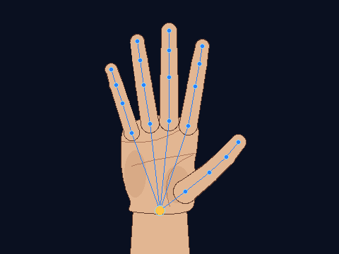
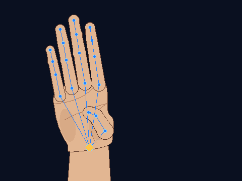
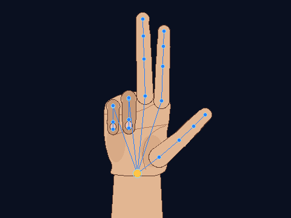
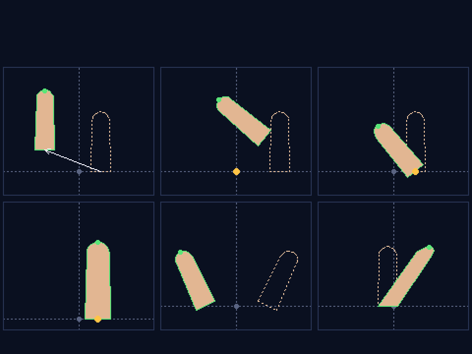
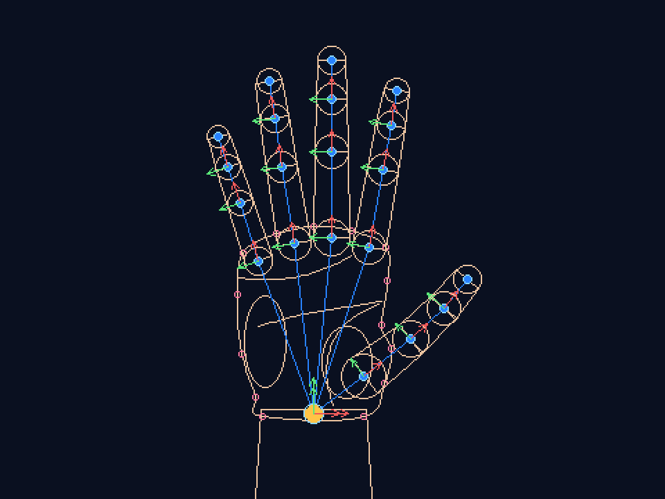
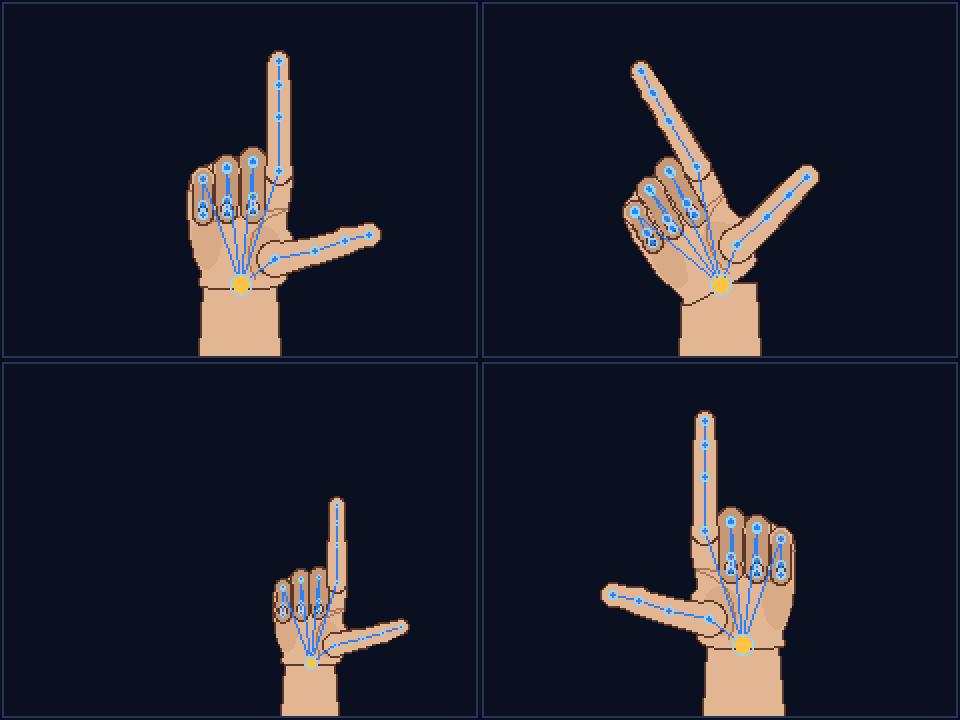
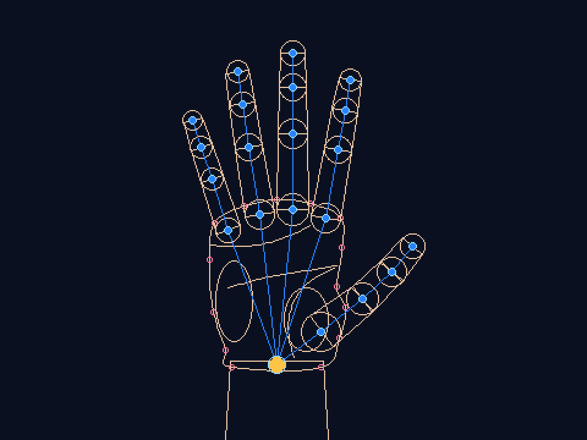

# Sign Language Gesture Visualizer

An interactive visualizer that shows American Sign Language (ASL) handshapes and signs on a rigged hand, built for our Computer Graphics semester project. Learners can **watch** signs being made (Watch mode) and **pose the hand themselves** (Build mode).

**Current stage: Checkpoint 2 – Transformation and Animation.**

- **Checkpoint 1:** the hand is built from lines, circles, ellipses, polygons and curves.
- **Checkpoint 2:** every joint is placed with 3×3 transformation matrices and a matrix stack. The whole hand can be moved, rotated at the wrist, scaled and mirrored into a left hand. Six ASL signs are animated with keyframes, eased interpolation and spline motion paths.

Everything is our own **pure C++**, using only the standard library: the algorithms, the matrices, the animation, and the BMP and GIF writers that save the results.

| GOODBYE: rotation about the wrist | HELLO: translation along a motion path | NO: joint-angle keyframes |
|---|---|---|
|  |  |  |

*These GIFs were written by our own GIF encoder (`src/GifWriter.cpp`).*

| Transformations on a finger | The matrix stack: each joint's local frame |
|---|---|
|  |  |
| **One sign: original, wrist turned, scaled and moved, mirrored** | **Checkpoint 1: wireframe of every primitive** |
|  |  |

## Group members and responsibilities

| Member | Checkpoint 1 | Checkpoint 2 | Main files |
|---|---|---|---|
| Abdalla Muhammad (169962) | Hand rig, forward kinematics, drawing the hand, build setup | Transformation matrices, matrix stack, the hand's hierarchy and placement | `src/Hand.*`, `src/HandRenderer.*`, `src/Transform.*` |
| Elvis Wafuke (154210) | Lines (DDA, Bresenham, attributes), Bézier curves, splines, algorithm pages | Keyframe animation, easing, motion paths, the animated signs, the CP2 renderer | `src/RasterLines.cpp`, `src/Curves.*`, `src/TestScene.*`, `src/Animation.*`, `apps/cp2_animate.cpp` |
| Ilhan Hamud (169004) | Framebuffer and BMP output, polygon operations, circles, ellipses | Transformed primitives (rotated ellipses, frames), transformation pages, GIF writer | `src/Framebuffer.*`, `src/Geometry.*`, `src/RasterCircles.cpp`, `src/RasterEllipses.cpp`, `src/TransformedShapes.*`, `src/TransformScene.*`, `src/GifWriter.*` |
| Joy Wanjohi (159540) | Scan-line fill, line and polygon clipping, Canvas, Windows viewer | Watch mode, Build mode (picking joints with inverse matrices), both viewers | `src/RasterPolygons.cpp`, `src/Clipping.*`, `src/Canvas.*`, `apps/ViewerCore.*`, `apps/viewer_win32.cpp`, `apps/viewer_glut.cpp` |
| Benson Gitonga (156740) | Sign library, CP1 renderer, tests, documentation | 16-sign library, CP2 tests, documentation, build files | `src/Poses.*`, `apps/cp1_render.cpp`, `tests/`, `docs/`, `README.md`, `CMakeLists.txt`, `build.bat` |

## Technologies and tools

| Tool | Used for |
|---|---|
| **C++17** with the standard library only | All graphics, transformations, animation, and the BMP/GIF writers |
| Visual Studio 2022 (MSVC) or g++ | Compiling |
| `build.bat` / CMake (optional) | Building |
| Git and GitHub | Version control, issues, collaboration |
| Windows' built-in window functions (user32, gdi32) | Only for the interactive viewer `apps/viewer_win32.cpp`: opening the window, reading keys and the mouse, copying our finished pixels to the screen, and drawing text. All drawing is done by our code. |
| *Optional:* OpenGL + freeglut | An alternative viewer, `apps/viewer_glut.cpp`, that works the same way. OpenGL proper comes in Checkpoint 3. |

## Graphics techniques implemented so far

### Checkpoint 2 – transformations and animation

| Topic | Technique | Used in the project for | File |
|---|---|---|---|
| Homogeneous coordinates | 3×3 matrices; points (w = 1) and directions (w = 0) | Every point drawn | `Transform.*` |
| Basic transformations | Translation, rotation, scaling, reflection, shear | Moving, turning, scaling and mirroring the hand | `Transform.*` |
| Fixed-point transformations | Rotation about a pivot, scaling about a fixed point | Hand turns about the wrist; fingers turn about their knuckles | `Transform.*` |
| Composite transformations | Matrix multiplication (the order matters) | View × Forearm × Wrist × Joints | `Transform.*`, `HandRenderer.cpp` |
| Inverse transformation | Affine inverse | Build mode: mouse → joint angle | `Transform.*`, `ViewerCore.cpp` |
| Hierarchical modelling | Matrix stack (push / pop) | Forward kinematics of all 15 finger bones | `Hand.cpp` |
| Reflection | Mirror in the y-axis | Left hand from the right hand (`L`) | `Hand.cpp` |
| Window-to-viewport | As a matrix | Detail view, animation frame grids | `HandRenderer.cpp`, `cp2_animate.cpp` |
| Transformed primitives | Rotated ellipses as transformed polygons | Palm pads and nails on a turned hand | `TransformedShapes.*` |
| Keyframe animation | Keyframes, in-betweening, ease-in-out | 6 animated signs | `Animation.*` |
| Motion paths | Catmull–Rom spline through keyframe positions | The wrist's path in each moving sign | `Animation.*` |
| Time-based playback | Elapsed time × speed, looping | Viewer speed control | `Animation.*` |
| Animation output | Animated GIF writer with LZW compression | `anim_*.gif` | `GifWriter.*` |

How each one works, with worked examples: **[docs/cp2-transformations-animation.md](docs/cp2-transformations-animation.md)**.

### Checkpoint 1 – the technical foundation

| Topic | Algorithm(s) | Used in the hand for | File |
|---|---|---|---|
| Lines | DDA, Bresenham (all 8 octants) | Skeleton bones, outlines, curves | `RasterLines.cpp` |
| Line operations | Dashed/dotted patterns, thick lines, polylines | Window marker, motion paths | `RasterLines.cpp` |
| Circles | Midpoint circle (outline, filled, 8-way symmetry) | Knuckles, fingertips, joints | `RasterCircles.cpp` |
| Ellipses | Midpoint ellipse (two regions) | Palm pads, fingernails | `RasterEllipses.cpp` |
| Polygons | Scan-line fill with Edge Table + Active Edge Table | Forearm, palm, finger bones | `RasterPolygons.cpp` |
| Polygon operations | Shoelace area, convexity, point-in-polygon, centroid | Palm analysis, tests | `Geometry.cpp` |
| Line clipping | Cohen–Sutherland | Every line and outline | `Clipping.cpp` |
| Polygon clipping | Sutherland–Hodgman | Every filled shape | `Clipping.cpp` |
| Bézier curves | de Casteljau and Bernstein form | Palm crease lines | `Curves.cpp` |
| Splines | Catmull–Rom, uniform cubic B-spline | Smooth palm outline, motion paths | `Curves.cpp` |

How each one works: **[docs/algorithms.md](docs/algorithms.md)**.

## How to compile and run

### Option A – `build.bat` (Windows, recommended)

1. Open **Developer Command Prompt for VS 2022** from the Start menu. (It provides the `cl` compiler. `g++` also works if it is installed.)
2. Run:

```bat
cd /d C:\path\to\sign-visualizer
build.bat
bin\render_test.exe
bin\cp2_animate.exe
bin\sign_viewer.exe
```

| Program | What it does |
|---|---|
| `render_test.exe` | 94 automated checks. It should end with `ALL CHECKS PASSED`. |
| `cp2_animate.exe` | **Checkpoint 2 output:** 6 animated GIFs plus 15 images, written to `output_cp2`. |
| `cp1_render.exe` | Checkpoint 1 output: 29 images (all 16 signs, views, algorithm pages), written to `output`. |
| `sign_viewer.exe` | The **interactive window**. Click it, then use the keys below. |

### Option B – any system with g++

```bash
g++ -std=c++17 -O2 -Isrc src/*.cpp apps/cp2_animate.cpp -o cp2_animate
g++ -std=c++17 -O2 -Isrc src/*.cpp tests/render_test.cpp -o render_test
./render_test
./cp2_animate
```

### Option C – CMake

```bash
cmake -S . -B build
cmake --build build --config Release
```

This builds every program: the Windows viewer on Windows, and the OpenGL viewer wherever freeglut is installed.

### Interactive viewer controls

| Key | Action |
|---|---|
| `1`–`9`, `,` / `.` | Choose a sign (16 in total). The hand moves smoothly to it. |
| `P` | Play through all the signs |
| `W` | **Watch mode:** play an animated sign. Press again for the next one. |
| `[` / `]` | Playback speed: half / double (0.125× to 4×) |
| `B` | **Build mode:** drag a joint with the mouse to bend it; drag empty space to turn the wrist. `↑`/`↓` curl the selected joint, `←`/`→` bend it sideways. |
| `←` / `→`, `↑` / `↓` | Outside Build mode: turn the hand at the wrist / scale it |
| `L` | Left hand (reflection) |
| `R` | Reset the pose, wrist, scale and speed |
| `G` | Show every joint's local coordinate frame (the matrix stack) |
| `M` | Motion trails. While watching, this shows the wrist's motion path. |
| `C` | Detail view (clipping + window-to-viewport) |
| `T` | Pages: 5 algorithm pages, then 2 transformation pages |
| `D` / `F` / `S` / `X` | DDA↔Bresenham / wireframe / skeleton view / palm details |
| `+` / `-` | Bigger / smaller pixels (1× to 12×) |

## Output of `cp2_animate`

All of it, with captions: **[docs/CP2-graphical-output.pdf](docs/CP2-graphical-output.pdf)**. The GIFs are also in [docs/animations](docs/animations).

| File | Shows |
|---|---|
| `transform_1_basics.bmp` | Translation, rotation about the origin, rotation about the knuckle, scaling about a fixed point, reflection, shear |
| `transform_2_composite.bmp` | T·R vs R·T; rotation about a pivot step by step; a three-bone finger built with the matrix stack |
| `hand_frames.bmp` | Every joint's local frame (red = local x, green = local y) |
| `hand_placements.bmp` | One sign: original, wrist turned 30°, scaled 0.7 and moved, mirrored |
| `hand_left_right.bmp` | A right hand and its reflection, a left hand |
| `anim_1_hello.gif` … `anim_6_b-a-b-y.gif` | HELLO, GOODBYE, YES, NO, THANK YOU, and B-A-B-Y fingerspelled (20 frames per second) |
| `anim_*_frames.bmp` | Six moments of each animation |
| `anim_*_path.bmp` | Start (dim), end, and the wrist's motion path through the keyframes |

## Project structure

```
src/                     All graphics code - pure C++, no libraries
  Framebuffer.*            Pixel memory, point clipping, BMP writer
  Geometry.*               Points, rectangles, polygon operations
  Raster.h, Raster*.cpp    Lines, circles, ellipses, polygon fill
  Clipping.*, Canvas.*     Cohen-Sutherland, Sutherland-Hodgman, clip-then-draw
  Curves.*                 Bezier, Catmull-Rom, B-spline
  Transform.*              CP2: 3x3 matrices, basic transformations, inverse, matrix stack
  TransformedShapes.*      CP2: ellipses through any matrix, frame axes, arrows
  Hand.*                   Joint hierarchy (matrix stack), placement (move/rotate/scale/mirror)
  Poses.*                  The 16 signs (each = joint angles)
  HandRenderer.*           Draws the hand through View x Forearm x Wrist x Joints
  Animation.*              CP2: keyframes, easing, motion paths, the 6 animated signs, playback
  GifWriter.*              CP2: animated GIF writer with LZW compression
  TestScene.*              The 5 CP1 algorithm pages
  TransformScene.*         CP2: the 2 transformation pages
apps/
  cp2_animate.cpp          CHECKPOINT 2 PROGRAM: GIFs + images (pure C++)
  cp1_render.cpp           Checkpoint 1 program: images (pure C++)
  ViewerCore.*             Everything the viewers do: modes, keys, Build-mode picking
  viewer_win32.cpp         Interactive window (Windows' own window functions only)
  viewer_glut.cpp          Alternative interactive window (OpenGL + freeglut)
tests/
  render_test.cpp          94 automated checks
docs/
  cp2-transformations-animation.md   CP2 techniques with worked examples
  algorithms.md                      CP1 algorithms with worked examples
  CP2-graphical-output.pdf, CP1-graphical-output.pdf   Screenshots with captions
  animations/, images/               GIFs and screenshots
build.bat                Builds everything on Windows
CMakeLists.txt           Optional CMake build
```

## Current progress

**Checkpoint 2 – done:**

- 3×3 homogeneous matrices for translation, rotation, scaling, reflection and shear, including rotation about a pivot, scaling about a fixed point, composition and the inverse.
- The CP1 hand rebuilt on a **matrix stack**: forearm → wrist → palm → knuckle → middle joint → end joint → fingertip. It gives exactly the same result as the CP1 trigonometry (checked by tests). The whole hand can now be moved, turned at the wrist, scaled and mirrored.
- Rotated ellipses, so the palm details stay correct on a turned hand.
- **Keyframe animation:** 6 animated signs with eased in-betweening, Catmull–Rom motion paths, holds, time-based playback and speed control.
- **Watch mode** and **Build mode** in the viewer. Build mode uses inverse matrices to turn the mouse into joint angles.
- The sign library grew from 8 to 16 handshapes.
- An animated GIF writer, written from scratch.
- 94 automated checks, all passing.

**Checkpoint 1 – done:** all the drawing algorithms, each used for a real part of the hand (see the table above).

**Next:**

- **Checkpoint 3:** move the components into OpenGL (its own matrix stack and real 3D) and build the prototype.
- **Final:** refine Watch and Build modes, add more signs and words, testing.

## Known limitations

- The hand is drawn in 2D from the front. Curling towards the viewer is shown by foreshortening, and coming closer by scaling. Real depth comes with 3D in Checkpoint 3.
- Rotated ellipses are drawn as transformed polygons, not with the midpoint algorithm, which only draws axis-aligned ellipses.
- Joint angles are interpolated linearly, so fingers can briefly pass through each other between very different handshapes (there is no collision detection).
- Build mode's joint limits are simple ranges, not real anatomy.
- Some signs (for example R, E and S) are front-view approximations of their handshapes.
- Edges are jagged (no anti-aliasing).

More detail: [CP2 write-up](docs/cp2-transformations-animation.md#known-limitations) and [CP1 write-up](docs/algorithms.md#11-known-limitations).
