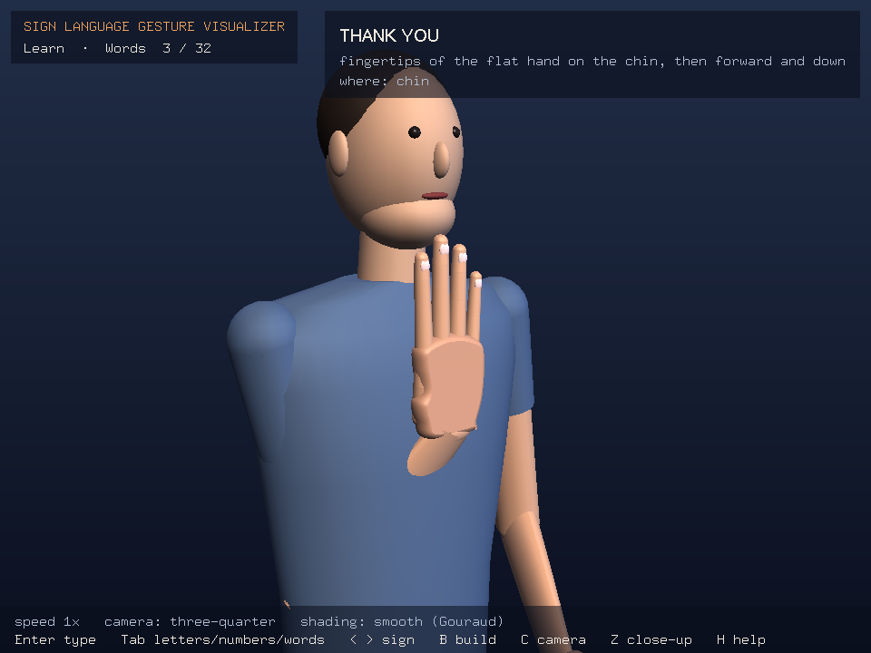
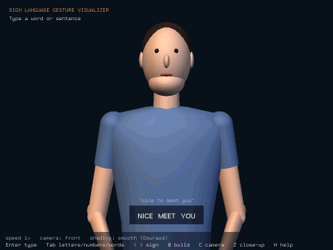
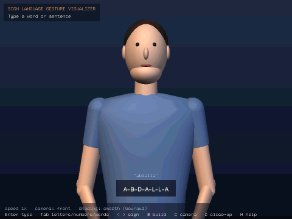
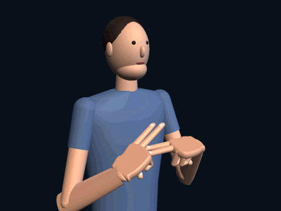

# Sign Language Gesture Visualizer

An interactive application for learning American Sign Language (ASL) on a rigged 3D hand, built for our Computer Graphics semester project. Learners can:

- **Learn** the whole manual alphabet (A–Z), the numbers 0–10 and 32 everyday conversation signs, each with a description of how it is made and where.
- **Type** a word or a sentence: known words are signed, other words such as names are fingerspelled, and subtitles show what is being signed.
- **Build** handshapes themselves by dragging the joints with the mouse.

**Stage: final project (Checkpoint 3 – OpenGL integration and prototype – and the final version).**



| Type a sentence: "nice to meet you" | Fingerspelling a name | Two hands: NAME |
|---|---|---|
|  |  |  |

*These GIFs were rendered by the application itself (`sign_studio --capture`) and saved by our own GIF writer.*

## How the project grew

| Stage | What it added |
|---|---|
| **Checkpoint 1** – core graphics | Every drawing algorithm in pure C++ (lines, circles, ellipses, polygon fill, clipping, curves), each used for a part of a 2D hand; 8 handshapes |
| **Checkpoint 2** – transformation and animation | 3×3 matrices and a matrix stack for the hand's hierarchy; keyframe animation with easing and motion paths; Watch and Build modes; GIF writer; 16 handshapes |
| **Checkpoint 3** – OpenGL integration | The same rig in 3D: 4×4 matrices, our own meshes, OpenGL rendering with lighting, shading and an orbit camera |
| **Final project** | Full alphabet and numbers, 32 conversation signs with a body reference and a second hand, type-a-word and sentence mode, close-up and signer's-view cameras, left-handed mode |

Nothing from the earlier checkpoints was thrown away. The 3D hand uses the CP1/CP2 joint angles and sizes; the palm is the CP1 spline outline extruded; screenshots go through our CP1 framebuffer and BMP writer; animations go through our CP2 GIF writer. The CP1 and CP2 programs still build and run.

## Group members and responsibilities

| Member | Checkpoint 1 | Checkpoint 2 | Checkpoint 3 and final | Main files |
|---|---|---|---|---|
| Abdalla Muhammad (169962) | Hand rig, forward kinematics, drawing the hand, build setup | Transformation matrices, matrix stack, hierarchy and placement | 3D maths (4×4 matrices, camera matrices), 3D hand and its meshes, two-bone arm | `src/Math3D.*`, `src/Hand3D.*`, `src/Mesh.*`, `src/HandMesh.*` |
| Ilhan Hamud (169004) | Framebuffer and BMP output, polygon operations, circles, ellipses | Rotated ellipses, transformation pages, GIF writer | OpenGL renderer: lighting, materials, shading modes; orbit camera; body reference; median-cut colours for GIFs | `src/GLRenderer.*`, `src/Camera.*`, `src/Body.*`, `src/GifWriter.*` |
| Elvis Wafuke (154210) | Lines, Bézier curves, splines, algorithm pages | Keyframe animation, easing, motion paths, CP2 renderer | Two-hand timeline; type-a-word and sentence mode; the capture tool (screenshots and GIFs) | `src/Timeline.*`, `src/Speller.*`, `apps/StudioCapture.*` |
| Joy Wanjohi (159540) | Scan-line fill, clipping, Canvas, Windows viewer | Watch mode, Build mode (inverse matrices), both viewers | The 3D application: Learn / Type / Build modes, picking joints in 3D, the on-screen interface, the Windows (WGL) and GLUT windows | `apps/StudioCore.*`, `apps/studio_win32.cpp`, `apps/studio_glut.cpp` |
| Benson Gitonga (156740) | Sign library, CP1 renderer, tests, documentation | 16-sign library, CP2 tests, documentation, build files | All handshapes (A–Z, 0–10), the 32 conversation signs, 52 new checks, documentation, build files | `src/Handshapes.*`, `src/Signs3D.*`, `tests/`, `docs/`, `README.md`, `build.bat`, `CMakeLists.txt` |

## Technologies and tools

| Tool | Used for |
|---|---|
| **C++17** with the standard library | All the graphics code |
| **OpenGL 1.1** (the version every Windows PC has) | Drawing the 3D scene: vertex arrays, depth buffer, fixed-function lighting. We give OpenGL our own matrices; no GLU. |
| Windows' window functions + WGL | Opening the window and creating the OpenGL context on Windows: **nothing to install** |
| *Optional:* freeglut | The same application in a GLUT window (Linux, macOS, or Windows with freeglut) |
| Visual Studio 2022 (MSVC) or g++; `build.bat` / CMake | Compiling and building |
| Git and GitHub | Version control, issues, collaboration |

## Graphics techniques

### Checkpoint 3 and the final project – 3D and OpenGL

| Topic | Technique | Used for | File |
|---|---|---|---|
| 3D homogeneous coordinates | 4×4 matrices: translation, rotation about x/y/z and any axis (Rodrigues), scaling, reflection; general inverse | Every vertex of the scene | `Math3D.*` |
| Hierarchical modelling in 3D | 4×4 matrix stack | Forward kinematics of all 15 finger bones, in 3D | `Hand3D.cpp` |
| Viewing | `lookAt` view matrix, perspective projection, projecting points to the window | Orbit camera, presets, picking | `Math3D.*`, `Camera.*` |
| Meshes | Spheres, tapered tubes, profile tubes, an extruded outline with a rounded edge; smooth normals | Joints, bones, forearm, body, palm | `Mesh.*`, `HandMesh.*` |
| Triangulation | Ear clipping of a concave polygon | Front and back of the palm | `Mesh.cpp` |
| Normals under transformation | Inverse-transpose matrix; a mirror reverses the triangle winding | Scaled spheres, the left hand | `Mesh.cpp`, `GLRenderer.cpp` |
| Hidden surfaces | Depth buffer, back-face culling | The whole scene (replaces the painter's algorithm) | `GLRenderer.cpp` |
| Lighting | Phong reflection model (ambient + diffuse + specular), 3 lights, materials | Skin, nails, clothing | `GLRenderer.cpp` |
| Shading | Smooth (Gouraud), flat, wireframe | Comparing shading methods (`S`) | `GLRenderer.cpp` |
| Inverse kinematics (analytic) | Two-bone arm: law of cosines + a pole direction | Placing the elbow so the arm follows the hand | `HandMesh.cpp` |
| Contact search | Coordinate descent on joint angles | Thumb touching a fingertip (O, F, D, 6–9, flat-O) | `Hand3D.cpp` |
| Placing against the body | Solve for the wrist so a hand point lands on an anchor | "Fingertips on the chin", "palm on the chest" | `Hand3D.cpp`, `Body.*`, `Signs3D.cpp` |
| Two-hand keyframe animation | Eased interpolation, Catmull–Rom wrist paths, holds, joined timelines | All signs and sentences | `Timeline.*` |
| Picking in 3D | Project every joint with projection × view × model, take the nearest | Build mode | `StudioCore.cpp` |
| 2D overlay | Orthographic projection, alpha blending, bitmap text | Subtitles, panels, help | `GLRenderer.cpp`, `studio_*.cpp` |
| Reading back the picture | `glReadPixels` into our framebuffer; median-cut colour quantization for GIF | Screenshots and animations | `StudioCapture.cpp`, `GifWriter.cpp` |

How each one works, with worked examples: **[docs/final-3d-opengl.md](docs/final-3d-opengl.md)**.

### Earlier checkpoints

- **Checkpoint 2:** homogeneous 3×3 matrices, rotation about a pivot, composition, inverse, the matrix stack, reflection, window-to-viewport, keyframes with easing, motion paths, the GIF writer. See [docs/cp2-transformations-animation.md](docs/cp2-transformations-animation.md).
- **Checkpoint 1:** DDA and Bresenham lines, midpoint circle and ellipse, scan-line polygon fill, Cohen–Sutherland and Sutherland–Hodgman clipping, Bézier curves and splines. See [docs/algorithms.md](docs/algorithms.md).

## How to compile and run

### Windows – `build.bat` (recommended)

1. Open **Developer Command Prompt for VS 2022** from the Start menu.
2. Run:

```bat
cd /d C:\path\to\sign-visualizer
build.bat
bin\render_test.exe
bin\sign_studio.exe
```

| Program | What it does |
|---|---|
| `sign_studio.exe` | **The final application** (3D, OpenGL). Click the window and press `H` for help. |
| `sign_studio.exe --capture` | Renders all the documentation images and GIFs into `output_final` |
| `render_test.exe` | 146 automated checks (CP1, CP2 and the 3D version). It should end with `ALL CHECKS PASSED`. |
| `cp1_render.exe`, `cp2_animate.exe`, `sign_viewer.exe` | The Checkpoint 1 and 2 programs, unchanged |

### Any system – CMake

```bash
cmake -S . -B build
cmake --build build --config Release
```

On Windows this builds `sign_studio`. With freeglut installed it also builds `sign_studio_glut`, the same application in a GLUT window.

### Controls of `sign_studio`

| Key / mouse | Action |
|---|---|
| `Enter` | Type a word or sentence; `Enter` again signs it (`Esc` cancels) |
| `Tab` | Letters / Numbers / Words |
| `←` `→` | Previous / next sign |
| `Space` / `P` | Replay / pause |
| `[` `]` or `↑` `↓` | Slower / faster (0.125× to 4×) |
| `B` | **Build mode:** drag a joint (down curls it, sideways spreads it). Arrow keys bend the selected joint, or turn the hand if none is selected. The closest letter or number is shown. |
| Mouse drag / wheel | Orbit the camera / zoom |
| `C` | Camera: front, three-quarter, side, signer's view |
| `Z` | Close-up that follows the hand |
| `S` | Shading: smooth, flat, wireframe |
| `L` | Lighting on / off |
| `K` / `G` | Skeleton / each joint's axes |
| `O` | Body reference on / off |
| `M` | Left-handed signer (the whole scene mirrored) |
| `R` / `H` / `Esc` | Reset / help / quit |

## What `sign_studio --capture` produces

All of it, with captions: **[docs/FINAL-graphical-output.pdf](docs/FINAL-graphical-output.pdf)**.

| File | Shows |
|---|---|
| `final_01_studio` | The application in Learn mode |
| `final_02_alphabet`, `final_03_numbers` | Charts of all 26 letters and the numbers 0–10 |
| `final_04_words` | Chart of the 32 conversation signs |
| `final_05_shading`, `final_06_lighting` | Smooth / flat / wireframe; lighting off / on, skeleton, joint axes |
| `final_07_cameras` | The four camera presets |
| `final_08_two_hands`, `final_09_left_handed` | A two-handed sign, and the same sign by a left-handed signer |
| `final_10`–`final_12_sentence` | "hello my name abdalla", with subtitles |
| `final_13_build` | Build mode with a selected joint |
| `final_anim_*.gif` | HELLO, THANK YOU, NAME, "nice to meet you", and A-B-D-A-L-L-A fingerspelled |

## Project structure

```
src/
  (Checkpoints 1 and 2: pure C++ 2D graphics - see docs/algorithms.md and docs/cp2-...)
  Math3D.*       4x4 matrices, camera matrices, 3D matrix stack
  Hand3D.*       the rig in 3D, placement in body space, contact search
  Mesh.*         triangle meshes, ear clipping, smooth normals
  HandMesh.*     the hand's meshes, two-bone arm IK
  Body.*         head and torso reference, named anchors
  Camera.*       orbit camera and presets
  GLRenderer.*   OpenGL: lights, materials, shading modes, overlay
  Handshapes.*   A-Z, 0-10 and the extra handshapes
  Signs3D.*      letters, numbers and the 32 word signs as keyframes
  Timeline.*     two-hand keyframe animation and playback
  Speller.*      type a word or sentence -> one timeline
apps/
  StudioCore.*        the 3D application: modes, keys, picking, interface
  studio_win32.cpp    Windows window + OpenGL (nothing to install)
  studio_glut.cpp     the same with freeglut
  StudioCapture.*     renders the documentation images and GIFs
  cp1_render.cpp, cp2_animate.cpp, ViewerCore.*, viewer_*.cpp   (Checkpoints 1 and 2)
tests/
  render_test.cpp, final_tests.cpp    146 automated checks
docs/            write-ups, screenshot PDFs, images, animations, roadmap
```

## Known limitations

- **Hands only, no face.** ASL also uses facial expressions as grammar (for example raised eyebrows for a yes/no question); these are not shown. The head is a reference for location, not an avatar.
- **English word order.** Sentence mode signs words in the order typed and leaves out words ASL does not sign (a, the, is, to, …). It is not ASL grammar.
- **One citation form per sign.** Many signs have regional or personal variants. The signs follow common beginner references and should be checked by fluent signers before the tool is used as a reference.
- **No collisions.** Joint angles are interpolated, so fingers can briefly pass through each other between very different handshapes, and hands can touch the body slightly too deeply.
- **Stylised hand.** Bones are tubes and joints are spheres; there is no skin deformation or texture (textures were replaced by skin colour and shading).
- **Simple arm.** The elbow is placed by a two-bone solver, not by full body motion; the shoulders do not move.
- **Gouraud shading.** OpenGL 1.1 evaluates the Phong model per vertex and interpolates colours, so highlights are slightly softer than true per-pixel Phong shading.
- GIFs are limited to 256 colours per frame (median cut), so smooth gradients show slight banding.
